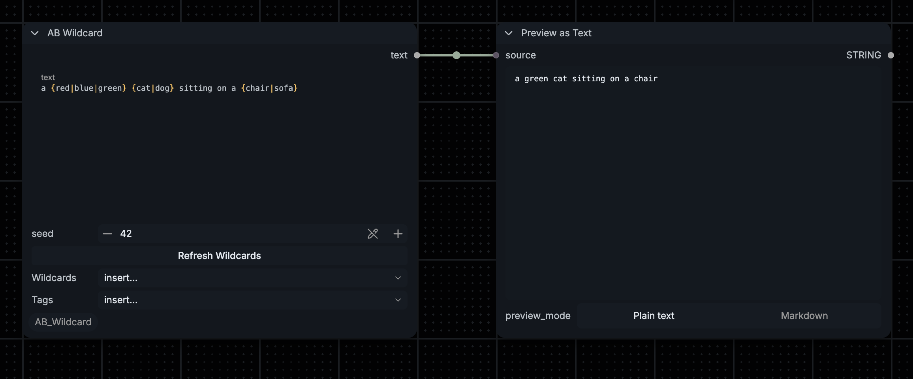
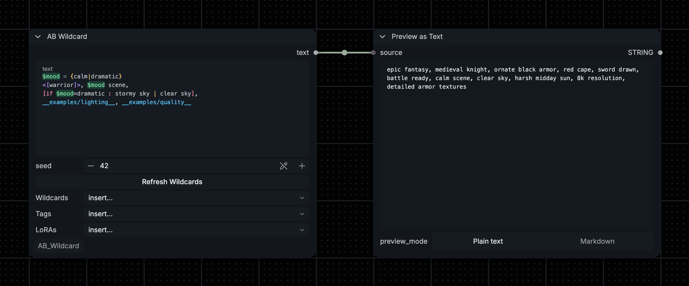
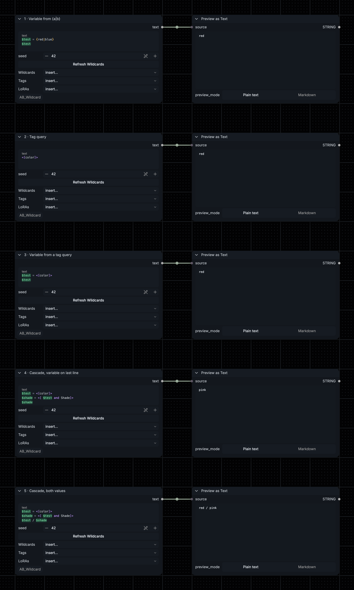
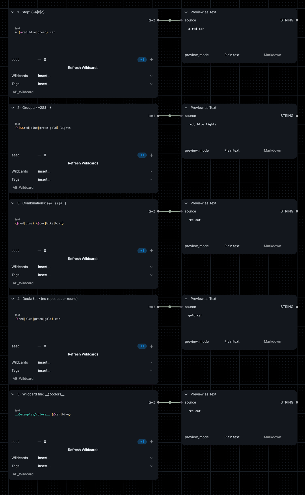
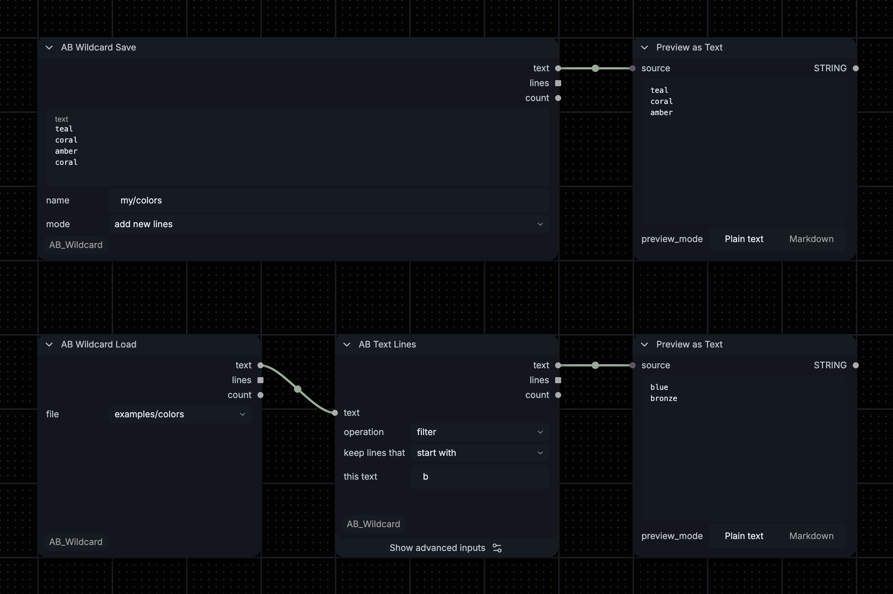
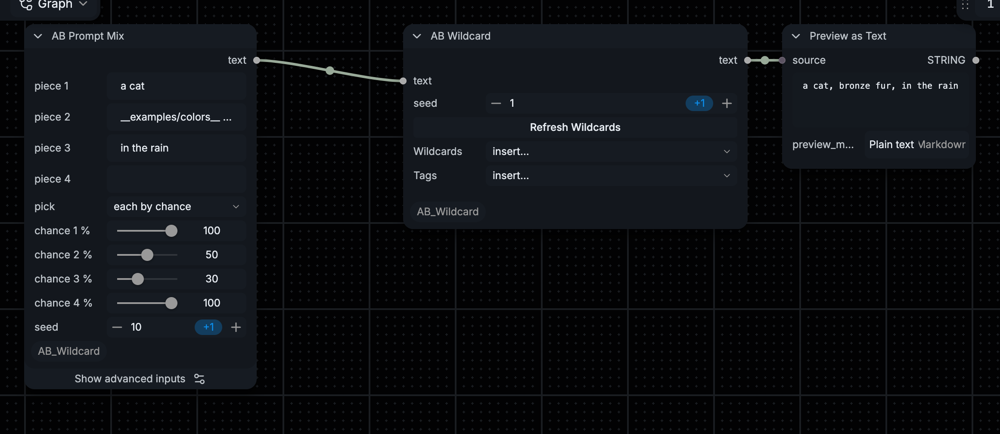
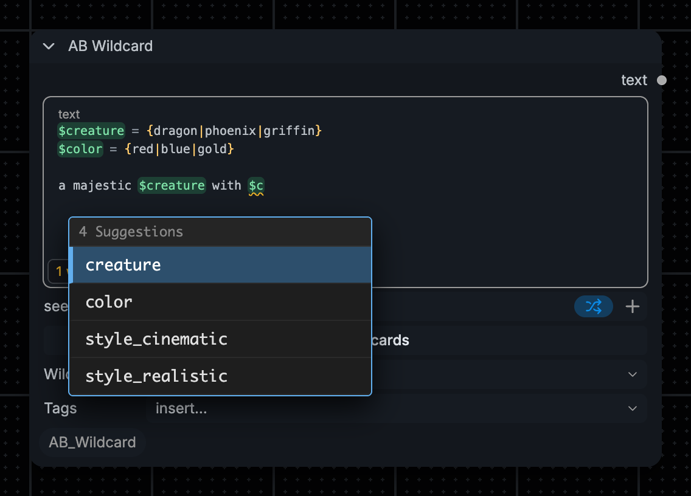
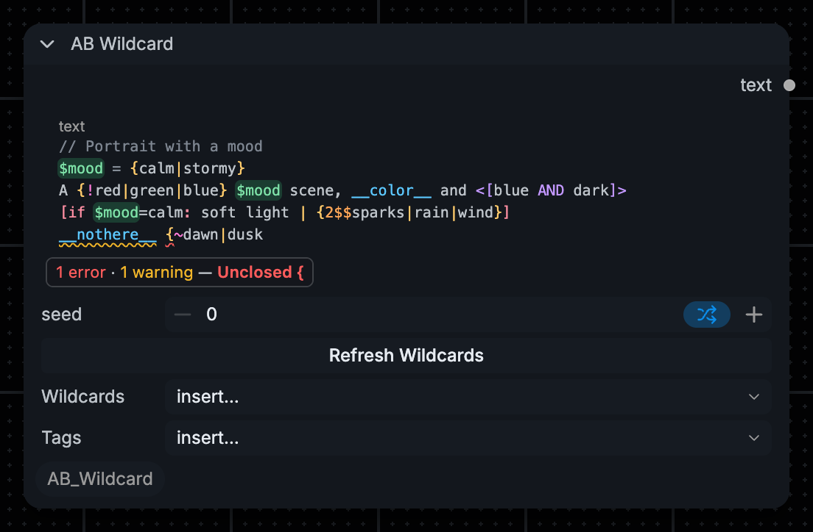
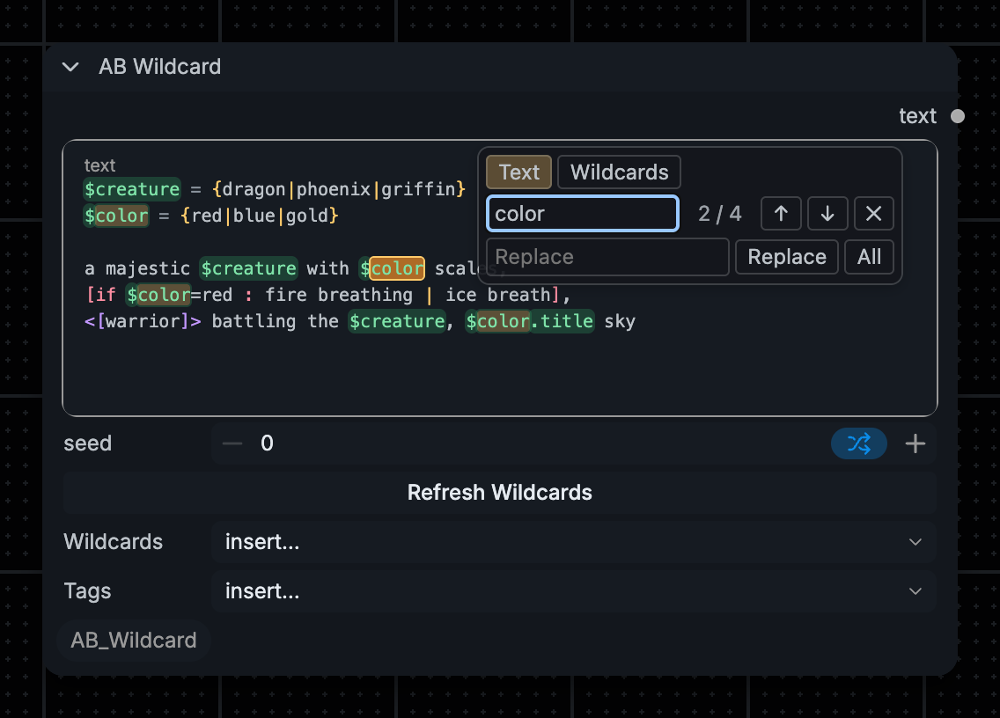
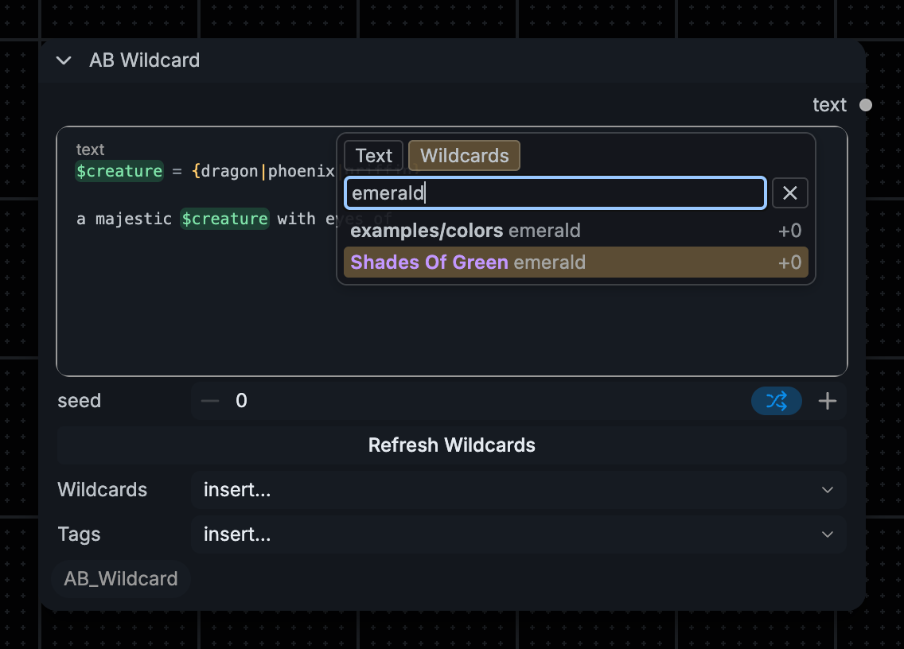

# AB Wildcard - ComfyUI Wildcard Processor

**A powerful text processing engine for ComfyUI prompts.**

Pure **text processing** focused on: Wildcards, Variables, Conditional Logic, Tag Aggregation, Weighted Selection, and Deep Nesting.

---

## Features

* **Wildcards** — Load random entries from `.txt` and `.yaml` files
* **Dynamic Choices** — `{a|b|c}` random selection with range support
* **Sequences** — `{~…}` step, `{@…}` all combinations, `{!…}` shuffled deck (no repeats per round)
* **Variables** — Define once (`$var={...}`), reuse everywhere (`$var`)
* **Conditional Logic** — `[if condition : true | false]` with AND/OR/NOT/XOR
* **Tag Aggregation** — `<[Tag]>` to pick from YAML cards by tag
* **Card by Title** — `__Card Name__` to pull a specific YAML card's prompt
* **Global Presets** — Auto-load variables from `globals.yaml`
* **In-node Helpers** — Autocomplete (type `__`, `<name`, `<[`, `$`) + Wildcards/Tags dropdowns
* **Syntax Highlighting** — Colours, variable chips and underlined mistakes while you type
* **Wildcard Files in the Graph** — Save and load wildcard files through node inputs and outputs
* **Text Tools** — Line operations in one node, and a mixer that lets prompt pieces through by chance
* **LLM Edits** — A text generator rewrites only the marked parts of a prompt (`[gen spin: …]`); the rest never passes through it

---

## Installation

```bash
cd ComfyUI/custom_nodes/
git clone https://github.com/a-und-b/ComfyUI_AB_Wildcard.git
pip install -r ComfyUI_AB_Wildcard/requirements.txt
```

Restart ComfyUI.

---

## Example workflows

The workflows are AB Wildcard nodes plus ComfyUI's core **Preview as Text** node, and need no models — except the two LLM workflows, which load a text encoder that can generate (see [LLM Edits](#llm-edits-on-marked-parts)).

**Basic** — [`ab-wildcard-example.json`](example_workflows/ab-wildcard-example.json): `{a|b}` choices.



**Features** — [`ab-wildcard-features.json`](example_workflows/ab-wildcard-features.json): a variable, a tag pick from a YAML card (`<[warrior]>`), a conditional on the variable, and two bundled wildcard files.



**Cascade** — [`ab-wildcard-cascade.json`](example_workflows/ab-wildcard-cascade.json): a variable set from a tag query and fed into a second query (`$shade = <[ $test and Shade]>`), using [`color-shades.yaml`](wildcards/examples/color-shades.yaml).



**Sequences** — [`ab-wildcard-sequences.json`](example_workflows/ab-wildcard-sequences.json): `{~…}` step, `{~2$$…}` groups, `{@…}` combinations, `{!…}` deck and `__@file__`, with the seed widget set to `increment` (see [Sequences](#sequences-step-through-options-in-order)).



**Build a list** — [`ab-wildcard-list.json`](example_workflows/ab-wildcard-list.json): **AB Wildcard Save** adds a typed list to `my/colors` and shows the whole file; **AB Wildcard Load** reads `examples/colors` and **AB Text Lines** keeps the lines that start with `b` (see [Wildcard Files and Text Tools](#wildcard-files-and-text-tools)).



**Mix pieces** — [`ab-wildcard-mix.json`](example_workflows/ab-wildcard-mix.json): **AB Prompt Mix** always uses `a cat`, adds `__examples/colors__ fur` in half the runs and `in the rain` in 30 %; **AB Wildcard** resolves the result.



**Full demo** — [`ab-wildcard-demo.json`](example_workflows/ab-wildcard-demo.json): every node of the pack in five annotated groups: the prompt syntax, sequences, saving and loading wildcard files, all six **AB Text Lines** operations side by side, and two **AB Prompt Mix** nodes feeding AB Wildcard. Running it creates `ComfyUI/wildcards/demo/colors.txt`.

**LLM edits** — [`ab-llm-slots.json`](example_workflows/ab-llm-slots.json): AB Wildcard → **AB LLM Prep** → core **Generate Text** → **AB LLM Apply**. A random pick inside `[gen fit: …]` is adapted to the rest of the prompt, `[gen spin: …]` and `[gen expand: …]` are rewritten, everything else stays as typed.

**Wildcard entries from an LLM** — [`ab-llm-wildcard-entries.json`](example_workflows/ab-llm-wildcard-entries.json): **Generate Text** lists 20 professions, **AB Text Lines** strips the numbering (replace, regex `^\d+[.:)]\s*`), **AB Wildcard Save** adds them to `llm/professions`.

1. Load a workflow file.
2. Edit the prompt text.
3. Queue it and read the expanded text in **Preview as Text**.

---

## Wiring

This node is **pure text processing** — it takes text input and outputs processed text.

| Output | Connect To |
|--------|-----------|
| `text` | CLIP Text Encode or any other text input |

---

## Wildcard Files and Text Tools

Four more nodes in **AB Utils** build and shape wildcard files inside a graph. They need a current ComfyUI (tested with 0.45.2) and show only the fields you need; rarely used ones sit under **Show advanced inputs**.

**AB Wildcard Save** saves lines as `ComfyUI/wildcards/<name>.txt` (subfolders allowed: `my/colors`). Type the list into `text` or connect one.

- `mode`: **add new lines** (only lines the file doesn't have yet), **add all lines**, or **replace file**.
- Outputs the whole file after saving: `text`, `lines` (a list: nodes after it run once per line) and `count`.
- The file works as `__my/colors__` right away, no **Refresh Wildcards** needed.
- Lines are trimmed and empty ones dropped. Names with `..`, absolute paths or a leading `~ @ !` are refused.
- ComfyUI skips a node whose inputs didn't change, so queuing the same text again doesn't add it twice.

**AB Wildcard Load** reads a `.txt` wildcard file chosen in `file`, with the same three outputs. Comments and empty lines are left out, as in `__name__`. New files appear in the list after reloading the browser page.

**AB Text Lines** does one job on a list of lines. Pick it in `operation`; only its fields show:

| operation | fields |
|-----------|--------|
| sort | `direction`: A → Z, Z → A, reverse order |
| filter | `keep lines that` contain, don't contain, start with, end with, are exactly, match regex · `this text` |
| replace | `find`, `replace with` · advanced: `use regex` (then `\1` inserts a group) |
| remove duplicates | advanced: `ignore case` |
| shuffle | `seed` |
| split and join | `split at`, `join with`: new line, comma, space or custom |

- Matching is plain text and ignores case, unless you choose regex.
- Lines are always trimmed and empty ones dropped. For several jobs, chain several nodes.
- By default the text is split at new lines and the output joined with new lines; change both under advanced.

**AB Prompt Mix** decides which prompt pieces get into a prompt. Type up to four pieces or connect them, then choose in `pick`:

- **each by chance**: every piece is used with its `chance %` (100 = always, 50 = half the runs, 0 = never), joined in slot order.
- **one by weight**: exactly one piece, chosen by the weights relative to each other.
- Same `seed`, same result. The mix has its own random generator, so it doesn't shift the picks of the AB Wildcard node. Pieces are joined with a comma; change it under advanced.

---

## LLM Edits on Marked Parts

Two nodes in **AB Utils** let an LLM rewrite parts of a prompt while the rest stays exactly as typed: **AB LLM Prep** turns the marked parts into one request, ComfyUI's core **Generate Text** node answers it, **AB LLM Apply** puts the answers back. The text outside the markers is copied by code and never passes through the LLM. The pack itself still makes no network calls: the LLM is whatever node sits between Prep and Apply.

```
AB Wildcard → AB LLM Prep ─system_prompt, prompt→ Generate Text ─generated_text→ AB LLM Apply → CLIP Text Encode
                   └──────────────────────── plan ───────────────────────────────────┘
```

| Marker | What the LLM does |
|--------|-------------------|
| `[gen: a profession fitting the character]` | writes what it asks for |
| `[gen spin: red silk dress]` | same meaning, other words |
| `[gen expand: castle]` | more detail |
| `[gen short: …]` | shorter, keeps the core |
| `[gen fit: {viking\|pirate}]` | adapts it to the rest of the prompt, keeps its core |
| `[gen do (a 1920s version): astronaut]` | follows your own instruction |

**Hints.** Any part takes a hint in brackets before the colon: `[gen expand (focus on light and weather): castle]`, `[gen spin (more gothic): red silk dress]`. No `:` inside the hint.

**Directions for every part.** These markers are not rewritten themselves; every part follows them, and they are removed from the finished prompt:

| Marker | Guides every part toward |
|--------|--------------------------|
| `[gen theme: dark fairy tale, muted colors]` | a theme or style |
| `[gen angle: low angle, 24mm lens]` | a camera position: parts are written as seen from there |
| `[gen avoid: modern objects]` | leaving things out |

Pick them with wildcards like anything else: `$cam = {low angle|bird's eye view}`, then `[gen angle: $cam]` for the LLM and `$cam` in the prompt if the image model should get it too.

Wildcards inside a marker resolve first, so `[gen fit: {viking|pirate}]` arrives as `[gen fit: viking]`: `fit` smooths a random pick without touching anything else. `#` and `//` inside a marker are removed as comments, like everywhere in AB Wildcard.

**AB LLM Prep**

- `scope`: what the LLM reads besides the parts — **full** the whole prompt, **input** only the text wired into `context`, **none** just the parts. `fit` needs full or input.
- `default operation`: for a text without markers, run this on the whole text (**none** · spin · expand · short · fit). So "shorten the whole prompt" needs no marker.
- Outputs `system_prompt` and `prompt` for Generate Text, and `plan` for Apply. `plan` has its own type, so it can't land in a text input by mistake.

**AB LLM Apply** takes `plan` and `generated_text`, and outputs `text` and a `report` with one line per part: the new text, or why it kept the original. A part keeps its original text when the answer has no line for it, the line is empty, or a `short` answer is longer than the original.

**No parts, still a tiny run.** Without markers and with default operation none, Prep sends Generate Text a trivial request ("Reply with OK."), and Apply passes the text through unchanged. Blocking the run instead would block the image too. It costs a few tokens on an encoder that is loaded anyway.

**Which encoder.** Generate Text runs on the text encoder you already load for the image model, through a **Load CLIP** node. Not every encoder file can generate text — some ship without the language-model head and fail inside Generate Text before Apply runs. Tested with ComfyUI 0.46.2:

| Encoder file (CLIP type) | Result |
|---|---|
| `qwen3.5_9b_int8_convrot` (qwen_image) | follows every operation well — the best choice for spin, expand and fit |
| `qwen_3_4b` (lumina2) | works and is fast; spin and expand fine, `fit` and `[gen: …]` weaker |
| `qwen_3_8b_fp8mixed` (flux2) | can't generate (`'NoneType' object has no attribute 'device'`) |

The CLIP type only matters for loading; the same weights give the same text. Keep **thinking** off; `max_length` 512 is enough for a handful of parts.

**Building workflows with an LLM agent** (e.g. through a ComfyUI MCP server)? [`docs/llm-agents.md`](docs/llm-agents.md) has every node's API names, the syntax, discovery endpoints and ready-to-queue recipes.

**One node instead of three.** The subgraph blueprint **AB LLM Edit** (node library → subgraphs) bundles Prep, Generate Text and Apply: connect `text` and your `clip`, read `text` and `report`.

---

## Finding Wildcards (Autocomplete & Dropdowns)

Two ways to insert tokens without memorizing names:



- **Autocomplete** — type `__` (or `<` directly followed by a letter, e.g. `<co`) for
  wildcards/card titles, `<[` for tags, `$` for variables (`globals.yaml` names plus every
  `$name = …` in the field, wherever it is defined) and `$name.c` (first letter after the dot) for the modifiers
  `clean`, `upper`, `lower`, `title`.
  Navigate with arrow keys, accept with **Tab/Enter or mouse click**.
- **Dropdowns** — the node's **Wildcards** and **Tags** combos insert the
  matching token (`__name__` / `<[tag]>`) on selection.

Works in both the classic and **Nodes 2.0 (Vue)** renderer. Use **Refresh
Wildcards** after adding files.

---

## Syntax Highlighting and Diagnostics

The text field colours the syntax as you type and marks mistakes.



- **Colours** — comments, variables (as green chips), wildcards, tag queries, choices, sequences (`~ @ !`), counts and weights, `[if …]` and `[clean:]`.
- **Red wavy underline** — an error: an unclosed `{`, `[if`, `<[`, `[clean:` or `[shuffle:`, an unmatched `}`, or `[if` without `:`.
- **Amber wavy underline** — a warning: a wildcard or tag the server does not know, `$name` never assigned, a count larger than the option list (`{3$$a|b}`), an empty `{}`, two identical `{!…}` blocks (they draw the same option), or `{@…}` inside `{@…}` (not counted evenly).
- **Blue dotted underline** — a hint: a `//` or `#` inside a block or URL starts a comment.
- A strip at the bottom of the field gives the counts and the message at the caret.

Good to know:

- Your text is never changed; the colours are a layer behind the field.
- `$name` is only reported as unassigned in prompts without wildcards, cards or tag queries, because CSV columns and cards can set variables the field cannot see. Variables from `globals.yaml` count as assigned.
- **Refresh Wildcards** re-checks the names after you add files.

---

## Find and Replace

Click into the text field and press **Cmd/Ctrl+F**. A small bar opens on the field:



- Type to mark every match (case-insensitive, plain text — no regex); the current one is stronger, with a count like `2 / 5`.
- **Enter** / **Shift+Enter** jump to the next / previous match and scroll it into view.
- **Replace** swaps the current match, **All** swaps every match. One **Cmd/Ctrl+Z** in the field undoes the last replace.
- **Esc** closes the bar and puts the caret back in the field. Cmd/Ctrl+F outside the field is unchanged.

### Search wildcards by content

Switch the bar from **Text** to **Wildcards** to search your wildcard files and cards instead of the text field:



- Type at least two characters, e.g. `emerald`. One row per insertable token appears: the name (cards in colour), the first matching line as a preview, and `+n` for further matching lines.
- Files match on their name and every line (csv: every cell); cards on title, prompts, description and tags. Case-insensitive, plain text; name matches are listed first, at most 50 rows.
- **Arrow Up/Down** and **Enter**, or a click, insert `__token__` at the caret and close the bar. One **Cmd/Ctrl+Z** removes it again.
- Edited files show up after **Refresh Wildcards**, like autocomplete. The bar reopens in the mode you last used.

---

## Syntax Reference

### Wildcards

```text
__colors__              Pick random line from wildcards/colors.txt
__folder/file__         Supports subdirectories
__2$$colors__           Pick 2 random entries
__1-3$$colors__         Pick 1 to 3 random entries
<colors>                Same as __colors__
<#7$$colors>            Same pick everywhere that uses #7 (repeat it to reuse the entry)
```

### Random Choices

```text
{red|blue|green}        Pick one randomly
{2$$a|b|c|d}            Pick exactly 2
{1-3$$a|b|c|d}          Pick 1 to 3
{2$$ and $$a|b|c|d}     Pick 2, joined with " and " instead of ", "
{~a|b|c}                Sequential, see "Sequences" below
{50%yes|no}             50% chance for "yes", else "no"
{5::red|3::blue|green}  Weighted choice (red=5, blue=3, green=1)
{a|{b|{c|d}}}           Nested choices (unlimited depth)
```

### Sequences (step through options in order)

These don't pick at random: they step through the options. Set the node's
**seed widget to `increment`** and every queued run takes the next step. The
step is worked out from the seed alone, so the same seed always gives the
same prompt, and other random `{a|b}` blocks are not affected.

```text
{~a|b|c}                Step: a, b, c, a, … (option = seed mod count)
{~2$$a|b|c|d}           Step in groups: "a, b", then "c, d", then "a, b" …
{~2$$ and $$a|b|c|d}    Same, joined with " and "
{@a|b} {@x|y|z}         Combinations: every @ block counts like an odometer
                        (the first one turns fastest). 2×3 = 6 runs give
                        every pairing exactly once: a x, b x, a y, b y, a z, b z
{!a|b|c|d}              Deck: shuffled order, but every option comes up once
                        before any repeats (new shuffle each round)
{@2$$a|b|c}             Groups work with @ and ! too: a window of 2 that moves
                        with the counter (@), or 2 from the shuffled rounds (!)
__~colors__             Step through the lines of a wildcard file
__~2$$colors__          Lines of a file, two at a time
__@colors__             File joins the @ combinations
__!colors__             File lines as a shuffled deck
```

Good to know:

- Two identical `{!…}` blocks in one prompt draw the same option. Make the
  options differ, or use one block and a variable.
- `{@…}` blocks inside each other are not counted evenly; keep them side by side.
- `{~1-2$$…}` with a range picks the group size at random per run.
- A wildcard file name must not start with `~`, `@` or `!`.

Tip: to render an entire grid (e.g. 3 styles × 4 lights), use `@` blocks,
start the seed at 0 and queue 12 runs ("Batch count" 12, seed `increment`).

### Variables

```text
$color = {red|blue}     Define variable
$color                  Use variable (outputs "red" or "blue")
$color.clean            Replace _ and - with spaces
$color.upper            UPPERCASE
$color.lower            lowercase
$color.title            Title Case
```

### Conditional Logic

```text
[if red : fire theme | water theme]           If "red" in prompt
[if $var=fire : hot | cold]                   Variable equality
[if A AND B : both | not both]                AND logic
[if A OR B : either | neither]                OR logic
[if NOT dark : bright scene]                  NOT logic
[if (A OR B) AND NOT C : complex logic]       Grouping
```

### Tag Aggregation (YAML Cards)

```yaml
# In wildcards/chars.yaml
Fire Mage:
  Prompts:
    - "robed wizard, fire magic, flames"
  Tags:
    - mage
    - fire
```

```text
__Fire Mage__           Pick a prompt from the "Fire Mage" card by name
<[mage]>                Pick any entry tagged "mage"
<[mage AND fire]>       Pick entry with both tags
<[fire OR ice]>         Pick entry with either tag
```

### Utility Functions

```text
[shuffle: a, b, c, d]         Randomize order
[clean: text, , with, ,gaps]  Remove double commas/spaces
```

### Comments

```text
// This line is ignored
# This is also a comment
text here  // inline comment
```

---

## Wildcards Folder Structure

```
wildcards/
├── globals.yaml          # Auto-loaded variables
├── colors.txt            # Simple text list
├── styles.txt
├── examples/
│   ├── color-shades.yaml # Cards for the cascade example
│   ├── characters.yaml   # YAML cards with Tags
│   └── environments.yaml
└── PROMPT_TEMPLATES.txt  # Example prompts
```

### Text Files (.txt)

One entry per line:

```text
red
blue
green
```

### YAML Cards (.yaml)

```yaml
Card Name:
  Description:
    - Optional description
  Prompts:
    - "prompt text 1"
    - "prompt text 2"
  Tags:
    - tag1
    - tag2
  Prefix:
    - "prepended to prompt"
  Suffix:
    - "appended to prompt"
```

### Global Variables (globals.yaml)

```yaml
quality: masterpiece, best quality
style: cinematic lighting
```

These are available as `$quality`, `$style` in all prompts.

---

## Example Prompt

```text
// Variables for consistency
$creature = {dragon|phoenix|griffin}
$color = {red|blue|gold}

// Main prompt
__examples/quality__,
a majestic $creature with $color scales,
[if $color=red : fire breathing, flames | [if $color=blue : ice breath, frost | lightning crackling]],
__examples/lighting__,
{epic|dramatic|cinematic} composition

// Use character cards
<[warrior]> battling the $creature
```

---

## Tips

1. **Batch Generation** — Use ComfyUI's "Queue Batch" (not Latent batch size) for variations
2. **Hot Reload** — Click "Refresh Wildcards" button to reload files without restart
3. **Autocomplete** — Type `__` or `<name` (wildcards/cards), `<[` (tags), `$` (variables) or `$name.x` (modifiers); accept with Tab/Enter or click
4. **Find and replace** — Cmd/Ctrl+F in the text field; switch to Wildcards to search file and card contents
5. **Grow a list** — LLM or list node → **AB Wildcard Save** (add new lines) builds a wildcard file over many runs
6. **Debug** — Check the console for processing errors

---

## Development

```bash
pip install -r requirements-dev.txt   # pytest (runtime needs only pyyaml)
pytest
node tests/syntax.test.mjs            # tokenizer and diagnostics (plain node, no install)
```

**LLM edits on a live ComfyUI.** `scripts/llm_eval.py` queues a set of `[gen …]` prompts (baseline, theme, angle, avoid, hints, do, weights …) once per seed through `/prompt` and writes a Markdown report with each part's old and new text and flags such as `fallback`, `bleed` (theme words leaking in) or `weights` (lost `(word:1.2)`). Standard library only:

```bash
python scripts/llm_eval.py --server http://127.0.0.1:8188 --seeds 1-3 --show-prompt
python scripts/llm_eval.py --only theme,angle --clip qwen_3_4b.safetensors --clip-type lumina2
```

---

## License

MIT

---

## Credits

This node is a heavily modified fork of [UmiAI](https://github.com/Tinuva88/Comfy-UmiAI).

**Changes from original**:
- **Removed**: LLM integration, LoRA handling, resolution control, negative prompt handling, API calls
- **Added**: Weighted selection syntax (`{5::red|3::blue}`), deep nesting support, custom separators (`{2$$ and $$a|b}`)
- **Refactored**: Pure text processing focus, single output node, streamlined codebase

Many thanks to the original UmiAI developers for the foundational wildcard processing architecture.
